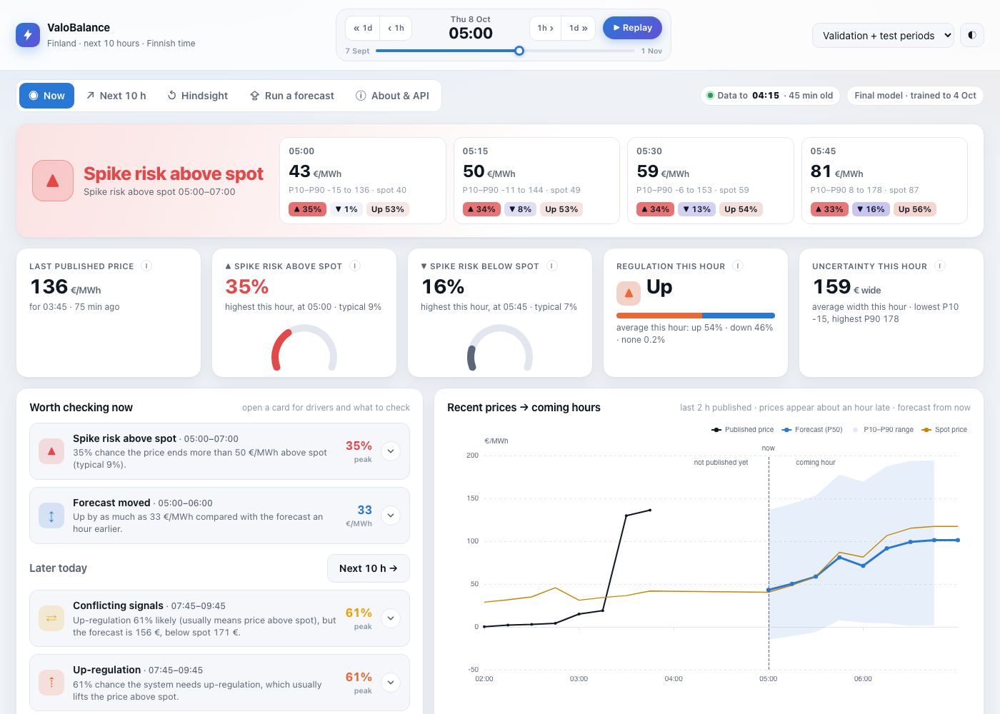
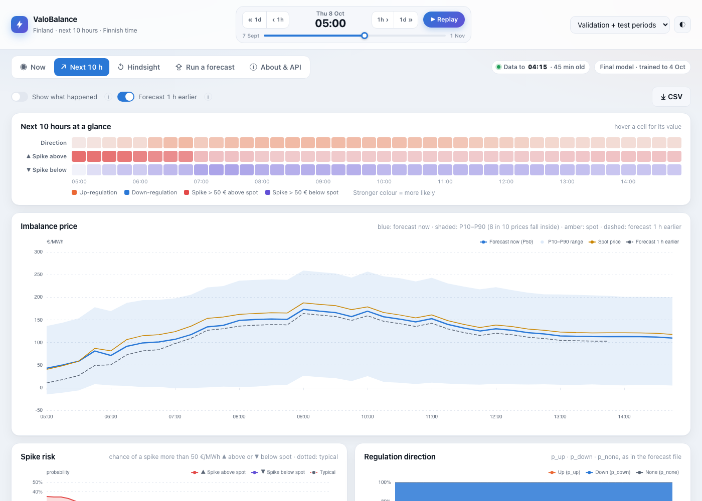
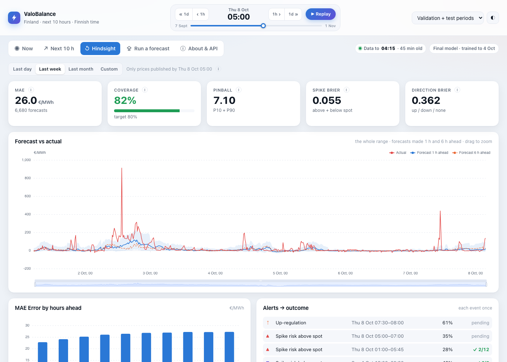
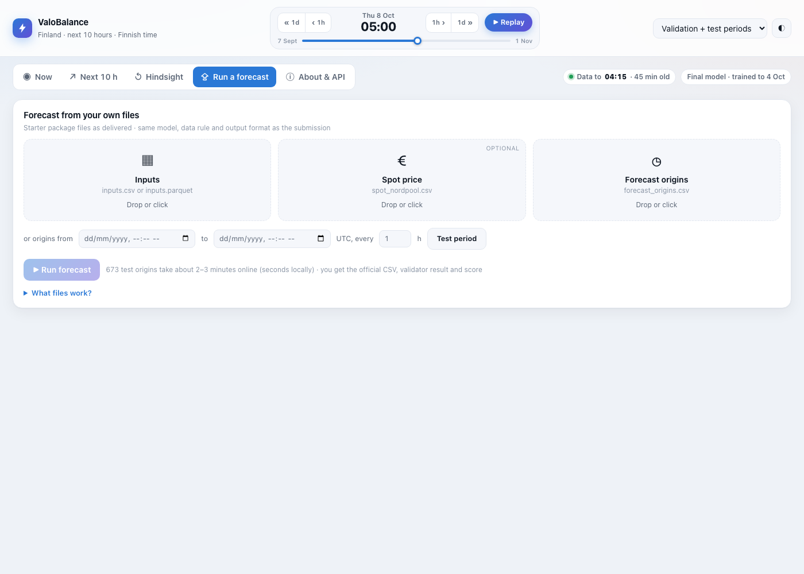
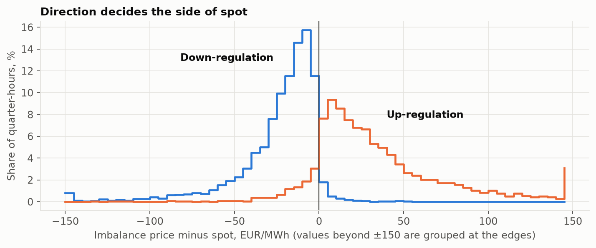
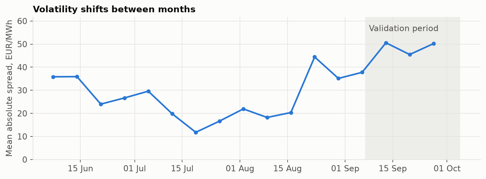
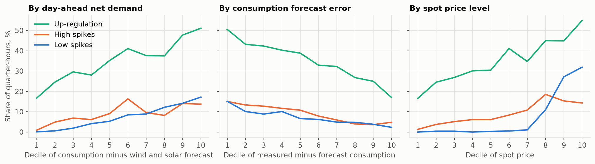
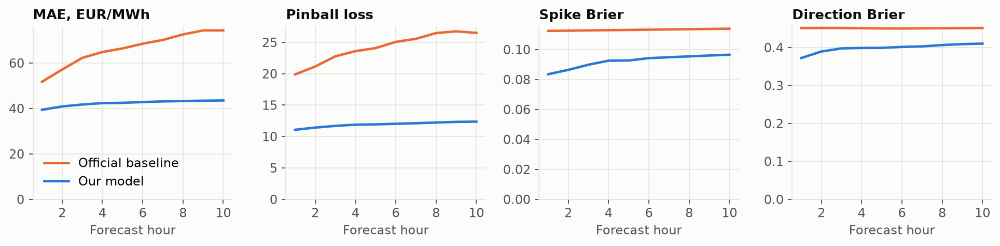

# Turku Energia imbalance price forecast

Forecast of the Finnish imbalance price for the next 10 hours in 15-minute steps: `p10`, `p50`, `p90`, regulation direction, spike probabilities and main drivers. Includes a dashboard (ValoBalance) for a shift supervisor or trader.

## Our result

Scored with the organisers' own `score.py` on 7 Sep - 4 Oct, trained only on data usable by 7 Sep:

| | Official baseline | **Our model** | Better by |
|---|---:|---:|---:|
| Price error (MAE, EUR/MWh) | 66.20 | **42.29** | 36% |
| Interval score (mean pinball) | 24.18 | **11.91** | 51% |
| Spike Brier | 0.1132 | **0.0922** | 19% |
| Direction Brier | 0.4509 | **0.3987** | 12% |
| P10-P90 coverage (target 0.80) | 0.68 | **0.79** | |

The same period helped us pick the design, so treat it as optimistic. The official validator passes on `outputs/forecast_backtest.csv`, and a leakage test checks that no feature can see data before it was usable.

## The dashboard

Run it with `python -m dashboard` and open http://127.0.0.1:8000.

**Now**: what needs attention in the coming hour, with plain-language alerts and the latest prices.



---

**Next 10 h**: direction and spike lanes, P50 with the P10-P90 range, and a CSV download.



---

**Hindsight**: how past forecasts did. Replay any moment and see only what was known then.



---

**Run a forecast**: upload the starter files, get a forecast and the official score.



## What we did

1. **Studied the price rules.** Spot is the anchor, regulation direction picks the side, so we predict the spread (imbalance minus spot), not the price.
2. **Built leakage-proof features.** Every value is read as of its `first_usable_origin_utc`. 21 features, strong regularisation.
3. **Trained LightGBM models** per group of forecast steps, averaged over seeds, for quantiles, spikes and direction.
4. **Tested choices on three time folds**, not one month. Simpler beat complex.
5. **Built the dashboard and API** so the forecast can be used, not just scored.

Full reasoning and numbers are in `docs/evaluation_report.pdf`.

### What the data showed

**Spread by direction.** Up-regulation prices sit above spot and down-regulation below it, so we model the spread to spot rather than the price itself.



---

**Weekly volatility.** The market's volatility shifts from week to week, which is why we test on three time folds.



---

Spikes and up-regulation follow system conditions: net demand, consumption forecast error and the spot level.



---

Our error stays almost flat over the 10 hours, while the baseline gets worse the further ahead it looks.



## Where things are

| What | Where |
|---|---|
| Forecast file | `outputs/forecast_backtest.csv` |
| Evaluation report | `docs/evaluation_report.pdf` |
| Data sources, models and licences | `docs/components.pdf` |
| Dashboard and API | `dashboard/` |

## Quick start with Docker (no Python setup)

Needs only Docker Desktop (Windows, macOS) or Docker Engine (Linux). Works on Intel/AMD and Apple Silicon machines. Run from this folder.

**1. Build the image** (once, about 3–5 minutes):

```bash
docker build -t turku-forecast .
```

**2. Run every step of the pipeline**, from the organiser files to the validated test forecast (about 15–20 minutes):

```bash
docker run --rm -v "$PWD/outputs:/app/outputs" turku-forecast
```

On Windows PowerShell, use `-v "${PWD}/outputs:/app/outputs"`. The forecast is written to `outputs/forecast_backtest.csv`, and the run prints each check (baseline, tests, folds, validation score, official validator).

**3. Open the dashboard (ValoBalance):**

Run it locally:

Start it with:

```bash
docker run --rm -p 8000:8000 turku-forecast python -m dashboard --host 0.0.0.0
```

Then open http://localhost:8000.

To run a single step, add the command at the end, for example `docker run --rm turku-forecast python -m pytest tests/ -q`.

## Manual setup

Python 3.11 or newer. Tested on macOS with Python 3.14. On macOS, LightGBM also needs `libomp`.

```bash
brew install libomp
python3 -m venv .venv
source .venv/bin/activate
pip install -r requirements.txt
```

## Running

Run from this folder, in this order. It takes about fifteen minutes.

```bash
python -m src.make_wide
python -m src.run baseline
pytest tests/
python -m src.run folds
python -m src.run validation
python -m src.run final
```

| Command | Purpose | Expected result |
|---|---|---|
| `src.make_wide` | Builds the wide tables from the organiser files | 0 cells differ from `inputs_wide_team.csv` |
| `src.run baseline` | Runs the organisers' baseline | MAE 66.20, pinball 24.18, spike 0.1132, direction 0.4509 |
| `pytest tests/` | Leakage and data tests | All pass |
| `src.run folds` | Trains and scores three time folds | Within 1.5% of the values in `src/config.py` |
| `src.run validation` | Scores 7 Sep - 4 Oct with the official validator and scorer | Within the limits in `src/config.py` |
| `src.run final` | Trains on data up to the cut-off and writes the test forecast | Official validator passes |

To open the dashboard and API at http://127.0.0.1:8000:

```bash
python -m dashboard
```

`dashboard/README.md` describes the views, the alerts and how to forecast from your own files.

To rerun the analysis after these commands:

```bash
cd notebooks
jupyter nbconvert --to notebook --execute --inplace 01_eda.ipynb
```

## Models

| Output | Model |
|---|---|
| `p10`, `p50`, `p90` | LightGBM quantile models on imbalance price minus spot, one per group of forecast steps, averaged over five step groupings. Spot is added back and the interval is widened by 1.25 |
| `p_spike_high`, `p_spike_low` | LightGBM binary models per group of forecast steps, averaged over three step groupings |
| `p_up`, `p_down` | Average of two LightGBM binary models and a logistic regression, per group of forecast steps, averaged over three step groupings |
| `p_none` | Constant, the share in the training data |

LightGBM models are averaged over five seeds. `top_drivers` lists the three largest SHAP contributions to `p50`.

## Validation

Official `score.py` for 7 Sep - 4 Oct, trained only on labels usable by 7 Sep:

| Forecast | MAE | Pinball | Coverage | Spike Brier | Direction Brier |
|---|---:|---:|---:|---:|---:|
| Official baseline | 66.20 | 24.18 | 0.68 | 0.1132 | 0.4509 |
| This model | 42.29 | 11.91 | 0.79 | 0.0922 | 0.3987 |

This period was also used to choose the design, so the score is optimistic.

## Data availability rule

- Features read each source at its last row with `first_usable_origin_utc` at or before the origin. All data access goes through `src/asof.py`.
- `tests/test_leakage.py` replaces every value not yet usable at an origin with garbage and checks that the features don't change. It covers validation and test origins, including the 25 Oct clock change.
- Labels are blank unless usable by `2026-10-04T21:00:00Z`. The final model trains on 117,860 rows, and the last delivery is 2026-10-04 19:45 UTC.
- All design choices were made on folds with labels usable by 4 Oct. An earlier version of the forecast was checked once against the package's test-period prices, and the later tuning used only the folds. After the final forecast was frozen, it was scored against the test-period prices to judge the result, and the dashboard's hindsight views show those outcomes. Nothing was changed because of these checks.

## Data

The organisers' input files are in long format, with one row per series and quarter-hour. The features need one column per series in time order, so we reshaped the files. Values were not changed.

| File in `data/` | Source | Use |
|---|---|---|
| `inputs.parquet` | Organisers, unchanged. Same data as `inputs.csv` | 32 input series |
| `spot_nordpool.csv` | Organisers, unchanged | Spot price |
| `actuals_validation.csv` | Organisers, unchanged | Scoring the validation period |
| `inputs_wide.csv` | Made by us | Value of each series at each quarter-hour |
| `inputs_usable.csv` | Made by us | First usable time of each of those values |
| `inputs_wide_team.csv` | Made by us | Our first wide file, used only as a cross-check |

`python -m src.make_wide` recreates `inputs_wide.csv` and `inputs_usable.csv`.

### Changes to the input files

| Change | Details | Reason |
|---|---|---|
| Combined sources | `spot_nordpool.csv` stacked with `inputs.parquet`, 479,925 rows | Spot is needed for the target and many features |
| Long to wide | 14,824 rows, 33 series, plus `timestamp_utc` | Rolling features need time-ordered columns |
| Regular grid | Every 15 minutes from `2026-05-31T21:00:00Z` to `2026-11-02T06:45:00Z`, in UTC | Shifts and rolling windows stay exact, including over the clock change |
| Missing rows left empty | 9,267 empty cells, mostly aFRR, where no row means no activation | Filling would invent data, and LightGBM handles empty cells |
| Separate table for usable times | `first_usable_origin_utc` in `inputs_usable.csv` | A table of values alone loses the availability rule |

We did no filling, smoothing, outlier removal or scaling in these files. Extreme prices are kept because they are real and scored.

`inputs_wide_team.csv` also has `timestamp_local`, `period` and `premium`, which we left out of `inputs_wide.csv`:

- `timestamp_local` repeats on the clock-change day.
- `period` marks 4 rows as validation although their labels aren't usable by the training cut-off.
- `premium` is the target.

### Training table

The wide file is not the training table. One wide row holds values from a single quarter-hour, including mFRR prices published after it, so training on those rows directly would be leakage. On the validation period this gave a MAE of 12.96 with same-row columns and 25.47 with all columns shifted by one row, against 42.29 for this model.

`src/features.py` builds one row per (origin, delivery), which is 40 rows per origin. Each row reads only values usable at that origin.

## Folders

```text
src/         code: config, make_wide, asof, features, models, submission, run
tests/       leakage, data and dashboard tests
dashboard/   dashboard page, API, alerts and forecast runs on uploaded files
notebooks/   exploratory analysis and validation diagnostics
docs/        report, component list, charts, measured values
data/        input files
organiser/   starter package templates, validator and scorer, unchanged
outputs/     forecast file and global drivers
artifacts/   models and scores, recreated by the commands above
```

`organiser/` contains `forecast_origins.csv`, `sample_submission.csv`, `availability.csv`, `make_templates.py`, `validate_submission.py`, `score.py` and `baseline.ipynb`.
