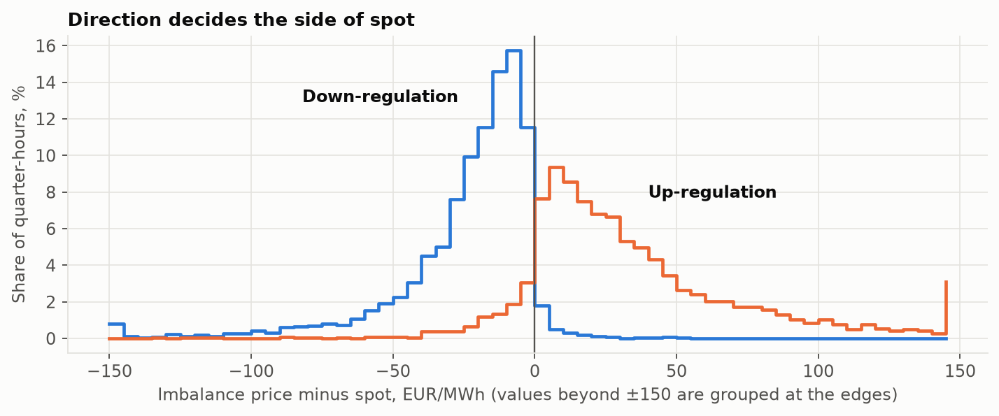
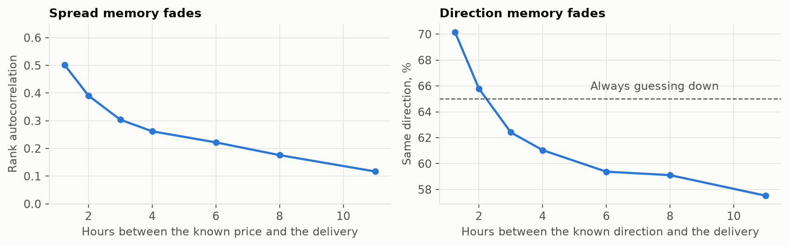
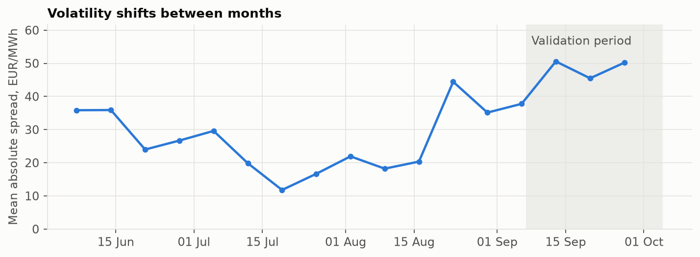
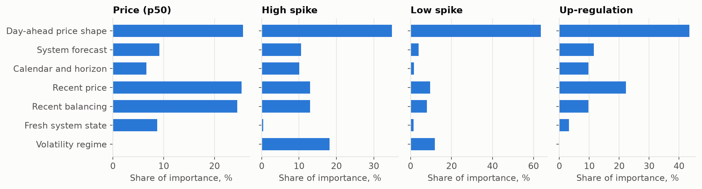
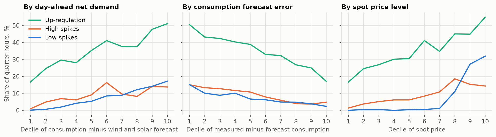
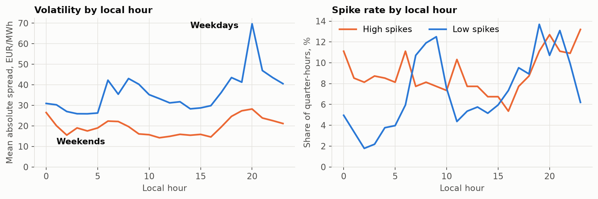
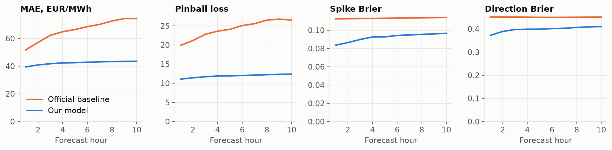
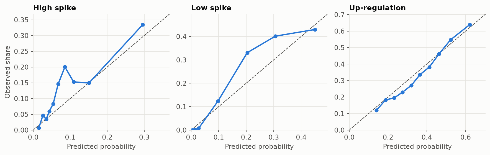
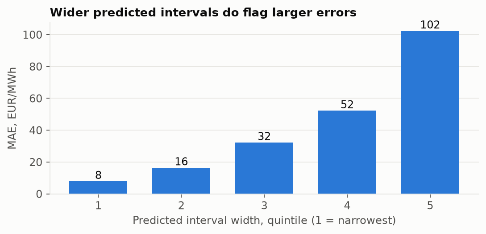
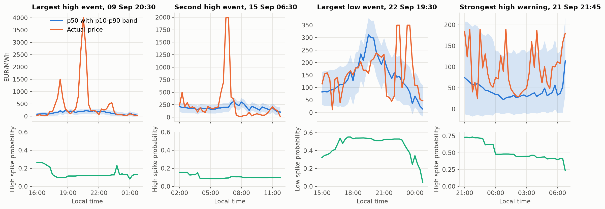

## Summary

We forecast the Finnish imbalance price for the next 10 hours in 15-minute steps, with an uncertainty interval, regulation direction, exceptional price probabilities and main drivers.

Against the official baseline on the validation period (7 Sep – 4 Oct 2026), measured with the official `score.py`:

| Forecast | MAE (EUR/MWh) | Mean pinball | P10–P90 coverage | Spike Brier | Direction Brier |
|---|---:|---:|---:|---:|---:|
| Official baseline | 66.20 | 24.18 | 0.68 | 0.1132 | 0.4509 |
| **Our model** | **42.29** | **11.91** | **0.79** | **0.0922** | **0.3987** |
| Improvement | 36% | 51% | Target about 0.80 | 19% | 12% |

Three findings shaped the solution:

1. **Simple beat complex.** Our first 89-feature model lost to "spot + median spread" on MAE. Cutting to 21 features with strong regularisation improved every metric.
2. **Spot is the best anchor.** We forecast the difference between imbalance price and spot, because spot is already published for all 40 steps at every origin.
3. **Risk can be forecast better than price.** Exact spikes remain hard to time, but the model does recognise when errors are likely to be large. In the widest fifth of its intervals, MAE is 102 EUR/MWh, against 8 in the narrowest fifth.

The validation period also helped us choose the design, so its scores are optimistic.

## 1. Reasoning chain

### Step 1: understand how the price is formed

The pricing rules give the model its structure: spot is the anchor, direction chooses the side, and the balancing price sets the distance. The training data confirms this:

| Direction | Quarter-hours | Price tracks | Correlation | Typical position against spot | Exceptional price rate |
|---|---:|---|---:|---|---|
| Up | 4,221 | mFRR up price | 0.993 | Above or equal in 90%; median +25.1 | High 25.5%, low 0.4% |
| Down | 7,851 | mFRR down price | 0.91 | Below or equal in 97%; median −17.0 | Low 11.0%, high 0.1% |
| None | 20 | Spot | n/a | Equal in all 20 cases | None |

This is why we predict the spread (imbalance price minus spot), not the price directly. On the validation period, this gave a MAE of 42.74 against 44.40 for the absolute price, using the same features and settings.

{width=68%}

### Step 2: respect what is known at forecast time

The newest imbalance price at any origin is already 1 h 15 old, so even step 1 isn't really "near". Measured system data is 45 minutes old at best, and neighbouring areas' prices are at least 2 h 15 old. Spot and day-ahead forecasts are published in advance and cover all 40 steps.

So each input comes from one of two kinds of source:

- **Target side:** published values for the delivery quarter-hour itself: spot shape, consumption and wind forecasts, net demand, calendar.
- **Origin side:** the latest values usable at the origin: recent spread, direction, mFRR premiums, consumption forecast error, net export.

The signal fades quickly with this delay. Spread rank autocorrelation is 0.50 at 1 h 15, 0.30 at 3 h and 0.12 at 11 h. Knowing the last direction is only better than always guessing "down" (65% of quarter-hours) up to about 2 hours ahead.

{width=85%}

This explains why our MAE barely changes across the horizon, from 41.3 in hour 1 to 43.6 in hour 10, while the baseline's persistence forecast worsens from 51.7 to 74.4.

### Step 3: plan for changing volatility

The market's volatility shifts between months, and the validation period is far more volatile than July.

| Month | Mean absolute spread | High spikes | Low spikes | Up-regulation |
|---|---:|---:|---:|---:|
| June | 32.4 | 12.0% | 7.4% | 38.3% |
| July | 18.0 | 2.7% | 0.5% | 30.6% |
| August | 29.6 | 10.5% | 6.6% | 38.8% |
| September | 45.0 | 10.1% | 14.9% | 33.3% |
| 1–4 October | 40.1 | 15.0% | 6.3% | 25.0% |

{width=68%}

With about 125 days of data and only 4 months of market conditions, the 118,000 training rows are heavily correlated. Models can easily memorise periods, and slow-moving features can act as date labels. That is the overfitting we found: removing volatility features from the full model improved validation MAE by 1.30 EUR/MWh.

We therefore use volatility features only in the spike models, where they protect scores in calm periods (fold F1 spike Brier 0.0231 without them, 0.0222 with them). Models stay small so they generalise.

### Step 4: choose the simplest design that holds up

We tested each choice on three time folds rather than one month. Each fold trains only on labels usable by its start date.

| Choice | Tested | Decision and evidence |
|---|---|---|
| Feature count | 89, 68, 21 | **21.** At the same settings, MAE skill against the benchmark improved from −5.7% to −3.0% to −1.6% across the folds |
| Regularisation | 31 leaves down to 4 | **Strong** (4–7 leaves, at least 2,000 rows per leaf). Validation pinball 13.11 to 12.46; direction Brier 0.4371 to 0.4064 |
| Target | Spread, absolute, volatility-scaled | **Spread.** MAE 42.74, 44.40, 43.20 |
| Recency weighting | 60, 30, 14-day half-lives | **None.** Small gains on the validation period, larger losses on fold F2 (pinball 8.25 to 9.50 at 14 days) |
| Mixture of up and down distributions | Inverted into quantiles | **Rejected.** Mean MAE 32.22 against 32.27, but worse pinball |
| CatBoost for price | Same features | **Rejected.** Mean MAE 32.94 against 32.27 |
| Spike models | Two binary, three-class, two-stage | **Two binary.** Effectively tied (0.0746, 0.0744, 0.0750), and simplest |
| Probability calibration | Platt scaling, two out-of-sample tests | **Rejected.** 3 of 6 tests improved and 3 worsened |
| Interval scale | Fixed, volatility-bucketed | **Fixed 1.25** (below). Buckets were unstable |
| Separate models by forecast step | Steps split into 2 or 3 groups, several splits averaged | **Kept.** Improved every metric on every fold: mean MAE 32.27 to 31.97, pinball 8.27 to 8.19, spike 0.0747 to 0.0741, direction 0.4196 to 0.4172 |
| Price model length and inputs | 200 to 1,000 trees; aFRR, faded last spread and 8 other feature groups | **400 trees, plus aFRR premiums and the faded last spread.** Other groups gave no consistent gain |
| Origin augmentation | Quarter-hour origins in training | **Rejected.** No gain |

We also compared classifier families directly, using the same features and folds. Each row shows the family's best setting for that output, as Brier score averaged across the three folds:

| Classifier | High spike | Low spike | Direction |
|---|---:|---:|---:|
| **Chosen design** | **0.0833** | **0.0663** | **0.4198** |
| XGBoost | 0.0835 | 0.0669 | 0.4218 |
| CatBoost | 0.0848 | 0.0677 | 0.4245 |
| HistGradientBoosting | 0.0829 | 0.0668 | 0.4215 |
| Random forest | 0.0846 | 0.0676 | 0.4214 |
| Extra trees | 0.0847 | 0.0675 | 0.4238 |
| Logistic regression | 0.0843 | 0.0859 | 0.4302 |
| Two-stage (direction × conditional spike) | 0.0838 | 0.0659 | n/a |
| Stacking, with weights from an earlier fold | 0.0877 | 0.0724 | 0.4202 |
| Best simple blend | 0.0825 | 0.0662 | 0.4196 |

The largest gain over the chosen design was 1.0%, and the day-level bootstrap ranges of the top candidates all included zero, so we kept the chosen design. Model type doesn't appear to be the main limit. These runs used only labels usable by the training cut-off, and test-period data played no part.

These comparisons were run with development scripts that aren't part of the submitted code. The submitted code reproduces the chosen design's fold results.

**Exceptional prices and direction are scored with Brier scores, so honest probabilities win.** We use no class weights, oversampling or decision thresholds in the forecast.

### Final models

| Output | Model | Inputs |
|---|---|---|
| `p10`, `p50`, `p90` | LightGBM quantile models on the spread, one per group of forecast steps, averaged over 5 step groupings and 5 seeds; spot added back; interval widened by 1.25 | 21 features + 2 aFRR premiums (+ 3 faded-spread features in one grouping) |
| `p_spike_high`, `p_spike_low` | LightGBM binary models, one per group of forecast steps, averaged over 3 step groupings and 5 seeds | 21 features + 4 volatility features |
| `p_up`, `p_down` | Average of two LightGBM binary models and a logistic regression, per group of forecast steps, averaged over 3 step groupings | 21 features |
| `p_none` | Constant training share (20 of 12,092 quarter-hours) | None |
| `top_drivers` | The three largest SHAP contributions to `p50` | From the `p50` models |
| `data_cutoff_utc` | Latest measured quarter-hour used | From the data |

**Why a blend for direction?** Logistic regression was the strongest single model on the validation period but weak on calm fold F1, while LightGBM was steadier. The blend had the best average across the folds (0.4196).

**Why separate models by step?** The nearest quarter-hours depend mostly on the latest known spread, the far ones on the day-ahead price shape. With large leaves, one model couldn't fit both well. Each group's minimum leaf size is scaled to its share of rows.

**Why widen by 1.25?** Unscaled intervals covered only 70% of prices on the volatile folds. Widening improves pinball in volatile periods and costs a little in calm ones.

| Scale | F1 (calm) | F2 | F3 |
|---|---:|---:|---:|
| 1.00 | 4.68 | 8.25 | 12.44 |
| 1.15 | 4.83 | 7.93 | 12.11 |
| 1.25 | 4.99 | 7.84 | 12.00 |

The best value is broad and flat. The scan above is for the earlier single-model design; for the final step-grouped design, 1.25 gave the best mean pinball across the folds.

### Step 5: prove that no future data is used

Using data before its first usable time scores 0, so we made the rule testable:

- **One access path.** Each feature reads its source at the last row usable at that origin, based on the organisers' `first_usable_origin_utc`.
- **Perturbation test.** For validation and test origins, including the 25 Oct clock change, every value not yet usable is overwritten with garbage. Features must stay **identical**. A second test confirms that changing a usable value does change them.
- **Blank labels.** Labels are blank unless usable by `2026-10-04T21:00:00Z`, so test-period prices can't reach training. The last training delivery is 4 Oct 19:45 UTC.
- **No tuning on the test period.** Every design choice, including the final step-grouped models, was made on folds with labels usable by 4 Oct. An earlier version of the forecast was checked once against the package's test-period prices; the later tuning used only the folds, and the final forecast was not scored on the test period.
- **A warning sign we measured.** Training directly on wide rows gave a validation MAE of 12.96 with same-row columns, and 25.47 with every column shifted by one row. Both are leakage. Our valid result is 42.29, and the oracle in section 3 shows why much lower is implausible.

## 2. Factors affecting the forecast

SHAP values are measured on validation-period rows, using models trained only on labels usable by 7 Sep. They explain what the model uses, and don't prove causes.

| Forecast | Main factors | How they push the forecast |
|---|---|---|
| Price (`p50`) | Spot level, latest spread, net export, 24-hour median spread, recent mFRR down and aFRR up premiums | Spot level and recent market state matter most. A higher recent spread raises the forecast, and a higher spot level lowers the expected spread |
| High spike | Daily spot range, wind forecast, latest spread, recent low-spike rate, spot level | A wide daily spot range and a high latest spread raise risk. Lower wind raises it too, but the effect is weaker and less consistent |
| Low spike | Spot level, daily spot range, position within the day | High spot, a wide daily range and hours above the daily mean all raise risk: the price needs room to fall |
| Up-regulation | Spot relative to its daily mean, daily spot range, latest spread, spot level | Hours priced above the daily mean, wide daily ranges and a high latest spread lean towards up-regulation |

**What the data shows about these factors** (training-period associations):

- **Low spikes depend strongly on spot level.** The rate is 0% in the lowest spot decile and 31.9% in the highest. This practical insight follows from the mechanism: a price 50 EUR/MWh below spot is only common when spot is high.
- **Scarcity leans towards up-regulation.** Up-regulation rises from 16.7% to 51.1% between the lowest and highest net demand deciles, and from 16.6% to 54.9% across spot deciles.
- **Consumption below forecast goes with more up-regulation.** The rate is 50.5% in the lowest error decile and 17.0% in the highest. This is an association, and could partly reflect consumption reacting to high prices.
- **Time of day and week matter.** Weekday mean absolute spread peaks at 69.7 at 20:00 local time. Weekends are much calmer: 19.6 against 36.1 on average, and 4.0% high spikes against 10.9%.

{width=85%}

## 3. Validation metrics

### Official scores

| Metric | Baseline | Our model |
|---|---:|---:|
| MAE of `p50` | 66.20 | **42.29** |
| Pinball, `p10` / `p90` | | 7.22 / 16.60 |
| Mean pinball | 24.18 | **11.91** |
| P10–P90 coverage | 0.68 | **0.79** |
| Brier, high / low spike | | 0.0990 / 0.0854 |
| Mean spike Brier | 0.1132 | **0.0922** |
| Three-class direction Brier | 0.4509 | **0.3987** |

Scored rows: 26,700. Observed high and low spikes: 12.1% and 13.0%.

### Honest benchmarks

The official baseline is easy to beat. These simple references show the real size of the edge:

| Reference | MAE |
|---|---:|
| Spot alone | 46.61 |
| Spot + training median spread | 44.30 |
| **Our model** | **42.29** |
| Oracle: spot + median spread given the **true** direction | 36.50 |

Our MAE is about 5% better than spot + median. Even knowing the true direction in advance would reach only 36.50 with this simple rule, so large MAE gains aren't available. The worst 1% of rows cause 20% of all absolute error.

### Results across folds

Each fold trains only on earlier data, and is compared with spot plus training-period statistics:

| Fold | Model MAE | Reference | Pinball | Reference | Spike | Reference | Direction | Reference |
|---|---:|---:|---:|---:|---:|---:|---:|---:|
| F1: 1–16 Aug, calm | 17.80 | 17.97 | 4.94 | 5.27 | 0.0220 | 0.0231 | 0.4279 | 0.4529 |
| F2: 17 Aug – 6 Sep | 35.79 | 37.83 | 7.69 | 11.55 | 0.1080 | 0.1323 | 0.4249 | 0.4790 |
| F3: 7 Sep – 4 Oct | 42.33 | 44.34 | 11.92 | 15.03 | 0.0923 | 0.1136 | 0.3987 | 0.4507 |

The model beats the reference on every metric in every fold, though only narrowly on calm-period MAE. Fold metrics leave out 40 rows whose labels fall after the training cut-off, so F3 differs slightly from the official scores above.

### Forecast skill by horizon

### Reliability

{width=85%}

Direction and low-spike probabilities follow the diagonal fairly closely. High-spike probabilities are too low in the middle range, because high spikes became more frequent in the validation period than in the training data. The final model also trains on this period, which should help.

## 4. Recognising when the error may be large

The brief says that the forecast isn't expected to be right all the time. What matters is that the uncertainty is calibrated and that the solution recognises when the error may be large.

**Interval width is a useful warning.**

{width=48%}

| Interval width, quintile | Mean width | MAE | Coverage | Errors above 100 EUR/MWh |
|---|---:|---:|---:|---:|
| 1, narrowest | 33 | 8 | 85% | 0.0% |
| 2 | 67 | 16 | 86% | 0.9% |
| 3 | 101 | 32 | 83% | 6.4% |
| 4 | 136 | 52 | 75% | 12.4% |
| 5, widest | 173 | 102 | 66% | 26.6% |

One limitation shows here: coverage falls to 66% in the widest group, so the intervals are still too narrow when conditions are at their most volatile.

**Risk probabilities also separate situations.**

| Rule | Share of quarter-hours flagged | Spike rate when flagged | Overall rate | Share of spikes caught |
|---|---:|---:|---:|---:|
| High spike ≥ 0.25 | 5.2% | 42.6% | 12.1% | 18.4% |
| High spike ≥ 0.35 | 2.6% | 55.7% | 12.1% | 12.0% |
| Low spike ≥ 0.25 | 20.2% | 41.5% | 13.0% | 64.6% |
| Low spike ≥ 0.35 | 11.2% | 42.3% | 13.0% | 36.6% |

High-spike warnings are precise but catch only a minority of events. Low-spike warnings catch most events, but more often flag quarter-hours where nothing happens.

### Case studies

The first three panels are the largest validation events, picked by size alone and seen from 4 hours before. The fourth is the origin with the model's strongest high-spike warning.

| Case | Forecast origin | What happened | What the model said | Verdict |
|---|---|---|---|---|
| 9 Sep 20:30 | 16:00 | Price 4,000 | `p50` 201, interval 86–276; high-spike risk 12%, near the 12% average; up-regulation 69% | **Missed.** Direction leaned correctly, but the size wasn't foreseen |
| 15 Sep 06:30 | 02:00 | Price 1,990 | `p50` 201, interval 102–283; high-spike risk 9%; up-regulation 56% | **Missed** |
| 22 Sep 19:30 | 15:00 | Price 156 against `p50` 312; a low spike | Low-spike risk 54%, against a 13% average | **Flagged.** 35% of the window's quarter-hours were low spikes; the model's average was 46% |
| 21 Sep 21:45 | 21:00 | Price 41, inside the interval −18 to 196 (`p50` 57) | High-spike risk 73% at this quarter-hour | **Window flagged correctly.** 53% of the window's quarter-hours were high spikes; the model's average was 51%. This quarter-hour itself wasn't one |

The lesson for a user: **read the risk probabilities alongside `p50`.** In the last case the price forecast stayed low, while the spike probability correctly warned that something was likely.

## 5. Limitations

- **Optimistic estimate.** The validation period influenced the choice of features and settings.
- **Extreme spikes.** Prices of 2,000–4,000 EUR/MWh weren't foreseen. Available data may not contain the triggers, such as unplanned outages, which aren't in the package.
- **Short history.** Four months cover no winter, and the test period includes a season change and a clock change not seen in training. Regularisation helps, but this can't be confirmed in advance.
- **Fixed calibration.** The interval scale is chosen from fold models and applied to a model trained on more data. Intervals remain too narrow in the most volatile conditions.
- **Forecast inputs.** Day-ahead forecasts in the package hold only the latest stored version, and there's no separate weather data.
- **Decision support only.** Open data doesn't show Turku Energia's available capacity, marginal cost, ramp limits or commitments. Outputs can suggest "check this situation", and not "offer this amount from this plant".

## 6. Data handling

The organisers' files are in long format. We reshaped them into one table of values and one table of first usable times, on a regular 15-minute grid. No values were changed, filled or removed, and extreme prices stay because they are real and scored. The training table is then built with one row per (origin, delivery) pair. The submission `README.md` gives details.

All analysis is in `notebooks/01_eda.ipynb`, and measured values are in `docs/eda_summary.json`.
